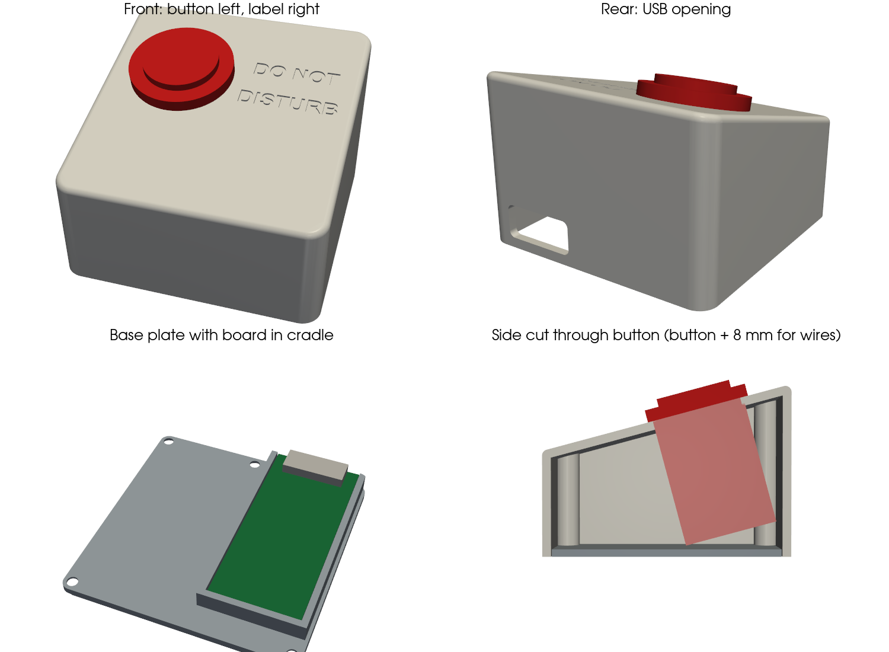

# Door sign

A button on my desk that switches the e-paper sign on my door between
**OPEN / Come on in** and a red **DO NOT DISTURB**. The LED inside the
button is lit while the door says Do Not Disturb.

An ESP32-S3 sends the image straight to the tag over Bluetooth. There's no
Home Assistant, Wi-Fi or hub involved. A press takes about 20 seconds to
upload, then the screen takes a little longer to redraw.



| Open | Do Not Disturb |
|---|---|
|  |  |

## Hardware

- **Sign:** 4.2" 400x300 black/white/red Bluetooth e-paper tag (Gicisky / PICKSMART type)
- **Board:** ESP32-S3 dev board, 28 x 63 mm, powered over USB-C
- **Button:** EG STARTS 30 mm arcade button with a 5V LED inside (M28 thread, nut mount)
- **LED driver:** NPN transistor (2N3904 or PN2222) and a 1 kΩ resistor
- **Case:** 3D-printed wedge with 4 x M3 x 10 mm countersunk screws

### Wiring

| From | To |
|---|---|
| Button switch terminal 1 | GPIO 4 |
| Button switch terminal 2 | GND |
| Board 5V | LED + |
| LED − | Transistor collector |
| Transistor emitter | GND |
| GPIO 5 | 1 kΩ resistor, then transistor base |

The board's built-in BOOT button also switches the sign, which is handy for testing.
See [case/ASSEMBLY.md](case/ASSEMBLY.md) for full build notes.

## Firmware

Built with [PlatformIO](https://platformio.org/) (Arduino framework, NimBLE-Arduino).

```bash
pio run -t upload
```

Settings are at the top of [src/main.cpp](src/main.cpp):

| Setting | Default | Meaning |
|---|---|---|
| `TAG_DIGITS` | `99830221` | Digits from the tag's barcode, used to find it |
| `BUTTON_PIN` | 4 | Desk button, wired to GND |
| `LED_PIN` | 5 | Button LED (through the transistor) |
| `COOLDOWN_MS` | 30000 | Ignores presses while the screen redraws |
| `MAX_ATTEMPTS` | 3 | Retries before giving up |

**How the LED behaves**

| LED | Meaning |
|---|---|
| Off | Sign says Open |
| On | Sign says Do Not Disturb |
| Slow blink | Sending |
| Fast blink for 3 s | Send failed, so the sign didn't change |

**What happens on a press:** the board remembers the tag's Bluetooth address after the
first success and connects to it directly. If that fails, it scans for 8
seconds and picks the tag by its barcode digits. The current sign and the
address are saved, so they survive a power cut.

### Bluetooth protocol

This follows the [ATC1441 BLE E-Paper Uploader](https://atc1441.github.io/ATC_GICISKY_Paper_Image_Upload.html):
service `FEF0`, with `FEF1` for commands and notifications and `FEF2` for image data. Each image is
sent uncompressed as 30,000 bytes: a 15,000-byte black layer (1 = light) then
a 15,000-byte red layer (1 = red), row by row, 8 pixels per byte.

## Changing the signs

Edit the PNGs in `images/` (400x300, black, white and red only), then rebuild
the header and flash:

```bash
python3 tools/make_images.py
```

```bash
pio run -t upload
```

## Case

The case is generated by [case/make_case.py](case/make_case.py) using [CadQuery](https://cadquery.readthedocs.io/).
Change the measurements at the top of the file and re-run it to regenerate the
STL and STEP files.

| File | Print notes |
|---|---|
| `case/case-top-print-this-way-up.stl` | Already rotated; top face on the bed, no supports |
| `case/case-base.stl` | Flat, cradle facing up, no supports |
| `case/button-hole-test.stl` | Optional test plate for the button hole size |

The top is 80 x 80 mm and slopes 15° from 34 mm at the front to 55 mm at the back.
The button needs a 28 mm hole.
